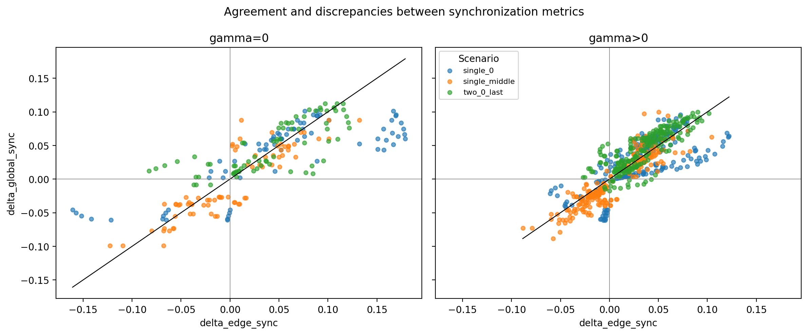
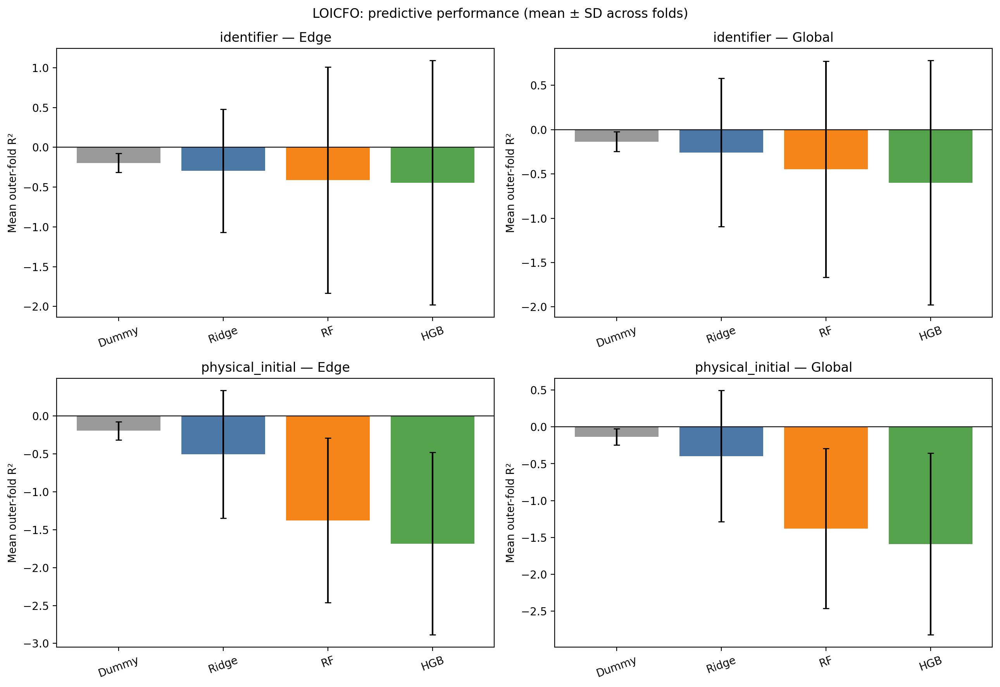
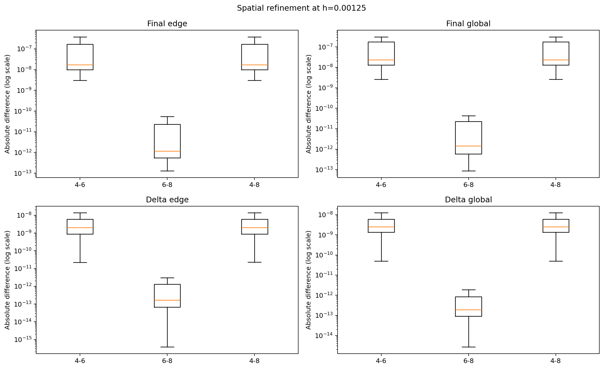
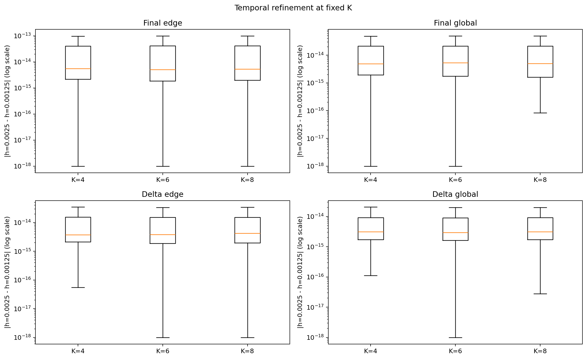

# Presentación oral — Controlabilidad y redes BBM

**Proyecto final · Maestría en Ciencia de Datos · Yachay Tech · Octubre de 2026**
**Duración:** aproximadamente 20 minutos, incluidas las pausas para mostrar figuras y una comprobación breve.
**Público:** personas sin especialización en control, ecuaciones diferenciales ni teoría de juegos.

> **Instrucciones de uso:** lee en voz alta los párrafos que aparecen bajo **Texto para leer**. Las indicaciones **En pantalla** son para ti y no se leen. Las tablas de variables son apoyos para explicar las ecuaciones, no listas que debas recitar. Los tiempos son orientativos; habla despacio y señala los gráficos.

**Ruta de exposición:** problema → BBM y grafos → controlabilidad → juego de Nash → bienestar → simulaciones → Machine Learning → sensibilidad → verificación → cierre.

---

## 1. Introducción: ¿de qué trata el proyecto? — 0:00 a 2:00

**En pantalla:** esta página. Señala el título del trabajo.

**Texto para leer**

Buenos días. Hoy voy a presentar un proyecto en el que combino matemáticas, teoría de grafos, teoría de juegos, simulación numérica y Ciencia de Datos. Su tema central es la **controlabilidad de sistemas BBM** y el estudio de lo que ocurre cuando varios sistemas de este tipo están conectados en una red.

Aunque los nombres puedan sonar técnicos, la idea principal se puede expresar con una pregunta sencilla: **si un sistema cambia con el tiempo, ¿podemos intervenir para modificar su comportamiento de la manera que queremos?**

Pensemos, por ejemplo, en un conjunto de elementos conectados. Cada uno evoluciona y puede influir sobre sus vecinos. En ciertos problemas nos interesa reducir diferencias entre ellos, comprender cómo se propagan las perturbaciones o evaluar la efectividad de un mecanismo de intervención.

En matemáticas, ese mecanismo se representa mediante un **actuador**. Un actuador es el medio por el que aplicamos una señal de control al sistema. Pero no basta con instalarlo o activarlo: debemos analizar qué componentes puede modificar y qué costo tiene utilizarlo.

En esta investigación aparecieron además dos preguntas: ¿qué sucede si distintos participantes deciden por separado qué controles activar?, y ¿podemos utilizar aprendizaje automático para predecir los resultados de numerosas simulaciones?

Por eso el proyecto tiene varias partes. Primero, un modelo matemático reducido que permite estudiar controlabilidad y decisiones estratégicas. Segundo, una campaña de simulaciones de redes BBM. Tercero, un análisis predictivo con Machine Learning. Y, finalmente, comprobaciones computacionales y de sensibilidad numérica.

Quiero aclarar algo desde el inicio: el juego matemático reducido y los experimentos con redes BBM son **estudios distintos**. Se relacionan por el tema general del control, pero los resultados de uno no demuestran automáticamente los del otro.

---

## 2. ¿Qué son BBM y los grafos? — 2:00 a 4:15

**En pantalla:** mantén esta sección; señala las palabras **onda**, **nodo** y **arista**.

**Texto para leer**

BBM corresponde a los apellidos **Benjamin, Bona y Mahony**, relacionados con un modelo matemático para describir la evolución de determinados fenómenos ondulatorios.

Una onda es una perturbación que cambia y se propaga. Una imagen sencilla es una ondulación que viaja sobre el agua. Un modelo matemático de ondas trata de representar qué ocurre con esa perturbación al pasar el tiempo, cómo se desplaza y cómo interactúan sus diferentes componentes.

En los modelos BBM aparecen efectos asociados con la propagación, la no linealidad y la dispersión. La **no linealidad** significa que el efecto de combinar dos perturbaciones no siempre es igual a sumar sus efectos por separado. La **dispersión** describe que distintas componentes de una onda pueden comportarse de manera diferente al propagarse.

Ahora incorporamos la teoría de grafos. Un grafo está formado por **nodos**, que son los elementos, y **aristas**, que son las conexiones entre ellos. Imaginen varios puntos unidos mediante líneas: esa representación ya es un grafo.

En una red BBM podemos asociar un sistema dinámico a cada nodo y estudiar cómo la conexión con otros nodos influye en su evolución. No todas las redes tienen la misma estructura: algunas presentan conexiones en cadena, otras forman ciclos y otras concentran muchas conexiones alrededor de un elemento central.

La palabra **topología** se refiere precisamente a la forma en que están organizadas esas conexiones. Cambiar la topología puede cambiar la respuesta colectiva del sistema.

En los experimentos de red también usamos un parámetro llamado **gamma**, que escribimos como $\gamma$. Este parámetro representa la intensidad del acoplamiento entre nodos: en los escenarios con $\gamma=0$ se elimina ese acoplamiento, y con valores positivos se estudian las interacciones correspondientes.

La pregunta que nos interesa pasa a ser: **¿cómo evolucionan varios sistemas conectados, cómo medimos si sus estados se parecen y qué sucede si intervenimos sobre ellos?**

---

## 3. ¿Cómo se representa matemáticamente el control? — 4:15 a 7:00

**En pantalla:** muestra primero la ecuación y después la tabla de rangos. No necesitas desarrollar operaciones algebraicas.

$$
\dot{x}_N(t)=A_Nx_N(t)+B_N(s)v(t).
$$

### Qué significa cada símbolo

| Símbolo | Explicación para el público |
|---|---|
| $t$ | Tiempo. |
| $x_N(t)$ | Estado del sistema reducido en el instante $t$. |
| $\dot{x}_N(t)$ | Cambio del estado con respecto al tiempo. |
| $N$ | Indica que trabajamos con un número finito de componentes o modos. |
| $A_N$ | Matriz de evolución natural del modelo lineal reducido. |
| $B_N(s)$ | Matriz que indica cómo influyen los controles según qué actuadores están activos. |
| $v(t)$ | Señal de control aplicada. |
| $s$ | Configuración de activación de los actuadores. |

**Texto para leer**

Esta es la ecuación principal del modelo lineal reducido. No voy a resolverla en la exposición; lo importante es entender qué representa.

El término de la izquierda indica **cómo está cambiando el sistema**. A la derecha aparecen dos contribuciones. La primera describe cómo evolucionaría por sus propias leyes, y la segunda representa lo que conseguimos al aplicar una señal de control.

La letra $x$ representa el estado: es la información matemática que necesitamos para describir la situación del sistema en un instante. La matriz $A$ representa su dinámica natural. La matriz $B$ indica por dónde entra la intervención. Y $v$ es la señal que decidimos aplicar.

¿Por qué aparece el subíndice $N$? Porque para realizar los cálculos trabajamos con una aproximación de **Fourier–Galerkin**. Esta técnica permite describir un comportamiento complejo utilizando un número finito de componentes más simples, llamados **modos espectrales**. Una analogía es representar un sonido complicado mediante varias frecuencias.

En el ejemplo de teoría de juegos del repositorio usamos **tres modos** y **dos actuadores**. Eso hace posible estudiar matemáticamente qué capacidad de control ofrece cada combinación.

Un concepto central es el **Gramiano de controlabilidad**. Es una matriz que resume información sobre cómo actúan los controles durante un intervalo de tiempo. También podemos examinar el **rango de la matriz de controlabilidad**, que, de forma intuitiva, nos dice cuántas direcciones independientes del estado pueden alcanzarse con las intervenciones disponibles.

| Decisión de los dos actuadores | Rango del ejemplo | ¿Controlable en el modelo de tres modos? |
|---|---:|---|
| $(0,0)$: ninguno activo | $0/3$ | No. |
| $(0,1)$: solo el segundo | $3/3$ | Sí. |
| $(1,0)$: solo el primero | $2/3$ | No completamente. |
| $(1,1)$: ambos activos | $3/3$ | Sí. |

Esta tabla ofrece una conclusión concreta: **dos actuadores no necesariamente tienen la misma capacidad de influencia**. En este ejemplo, el segundo por sí solo alcanza las tres dimensiones; el primero por sí solo, solamente dos.

Debo precisar que esto se demuestra para la **aproximación lineal finita** estudiada. No equivale a probar controlabilidad exacta de la ecuación BBM no lineal completa.

---

## 4. Actuadores, decisiones y equilibrio de Nash — 7:00 a 10:15

**En pantalla:** muestra cada ecuación cuando la menciones. Lo esencial es explicar el significado de 0 y 1.

$$
s=(s_1,s_2),\qquad s_1,s_2\in\{0,1\}.
$$

$$
c_1=(1,0,1)^\top,\qquad c_2=(1,1,1)^\top.
$$

$$
\mathrm{NE}_{\mathrm{puros}}=\{(1,0),(0,1)\}.
$$

### Diccionario de variables

- $s_1$: decisión del primer participante; **0** significa no activar y **1**, activar.
- $s_2$: decisión del segundo participante, con la misma interpretación.
- $c_1$ y $c_2$: perfiles que indican qué modos alcanza cada canal de control. Cada posición del vector corresponde a un modo del ejemplo.
- El símbolo $\top$ indica que interpretamos esos números como un vector columna.
- **NE** abrevia *equilibrio de Nash*.

**Texto para leer**

Hasta ahora estudiamos si es posible intervenir sobre el sistema. Pero supongamos que las decisiones sobre los actuadores no están en manos de una sola persona, sino de **dos participantes**.

Cada uno puede hacer una de dos cosas: activar su actuador o mantenerlo apagado. Activarlo proporciona cierta capacidad de intervención, pero también puede tener un costo. Además, los actuadores pueden estar realizando tareas que se superponen.

En nuestro ejemplo, el primer canal influye en el primero y el tercer modo. El segundo influye en los tres. Por eso los vectores que aparecen en pantalla tienen valores distintos.

Para cuantificar la similitud entre ambos canales utilizamos una medida llamada **redundancia modal**, representada por la letra rho, $\rho$. Para este ejemplo, $\rho=2/3$. Eso expresa que los perfiles tienen una superposición relevante según la medida definida en el modelo.

Aquí aparece la **teoría de juegos**. Esta herramienta estudia decisiones donde el beneficio de una persona depende también de lo que decidan otras personas.

Un **equilibrio de Nash** es una situación en la que nadie tiene incentivos para cambiar su decisión por sí solo, mientras los demás mantienen la suya. No significa necesariamente que sea la mejor situación para todos; solamente que es estable frente a cambios individuales.

Cuando el juego penaliza la redundancia entre controles, encontramos dos equilibrios puros: que se active solo el primero o que se active solo el segundo. Fíjense en algo importante: ya vimos que estas dos opciones no son idénticas desde la perspectiva de la controlabilidad. **Ser un equilibrio de Nash no garantiza que el sistema reducido sea completamente controlable.**

En cambio, cuando quitamos la penalización por redundancia, el ejemplo tiene como único equilibrio puro que los dos actuadores estén encendidos.

También calculamos un **equilibrio mixto**. En este caso las estrategias se expresan mediante probabilidades de activación:

$$
(p_1^*,p_2^*)=\left(\frac{33}{38},\frac{6}{17}\right)
\approx(0.868,0.353).
$$

Aquí $p_1^*$ es la probabilidad con la que el primer jugador activa su actuador, y $p_2^*$ es la probabilidad correspondiente al segundo. **No son porcentajes de éxito del control**, sino probabilidades estratégicas dentro de este juego matemático.

La conclusión es que los costos y la redundancia pueden cambiar qué decisiones resultan estables para los participantes.

---

## 5. Bienestar colectivo y precio de la anarquía — 10:15 a 12:00

**En pantalla:** muestra la fórmula y el resultado aproximado.

$$
\mathrm{PoA}=\frac{W^{\mathrm{opt}}}{W^{\mathrm{peor\ equilibrio}}}
=\frac{2584}{1605}\approx1.61.
$$

**Variables:** $W$ representa el **bienestar social**, según el criterio definido en el juego; $W^{\mathrm{opt}}$ es el mejor bienestar posible entre los perfiles estudiados; y el denominador es el bienestar del peor equilibrio relevante. PoA es la abreviatura inglesa de **precio de la anarquía**.

**Texto para leer**

Llegamos a otra pregunta: si cada participante toma decisiones buscando su propio beneficio, **¿qué tan bueno es el resultado para el grupo completo?**

Para estudiarlo usamos el concepto de **precio de la anarquía**. Este indicador compara el mejor bienestar colectivo que podríamos obtener mediante coordinación con el bienestar del peor equilibrio que puede aparecer cuando cada persona decide de manera individual.

En nuestro ejemplo, el mayor bienestar se alcanza cuando ambos actuadores están activos. Sin embargo, al considerar ciertos costos y penalizaciones, ese perfil no es un equilibrio puro del juego original con redundancia.

El precio de la anarquía calculado es aproximadamente **1.61**. Es una razón entre dos resultados del modelo matemático: no representa una cantidad de dinero ni significa que una red real haya perdido exactamente ese porcentaje de funcionamiento.

La investigación también analiza si es posible **cambiar los incentivos**. Para ello introduce transferencias compensadas: lo que recibe de más un participante lo aporta el otro, de modo que la suma de transferencias es cero.

La intensidad de este mecanismo se representa mediante el parámetro $\tau$, que se pronuncia «tau». En el ejemplo, si $\tau$ es estrictamente mayor que $22/255$, aproximadamente **0.0863**, el equilibrio pasa a ser únicamente aquel donde ambos controles están activos. En ese caso, el precio de la anarquía es 1.

La enseñanza es sencilla: **una organización adecuada de los incentivos puede acercar las decisiones individuales al objetivo colectivo**. Aquí es una conclusión teórica del juego finito, no una política que se haya aplicado a una instalación física.

---

## 6. Resultados de simulación: ¿cómo evaluamos la sincronización? — 12:00 a 14:00

**En pantalla:** señala la imagen y detente para que el público la observe.

**Texto para leer**

Pasamos ahora a los experimentos de **redes BBM**, que constituyen una parte distinta del juego de Nash.

En las simulaciones observamos cómo evolucionan sistemas conectados y utilizamos diferentes medidas para analizar su comportamiento colectivo.

Una de las preguntas es si los elementos de una red se comportan de forma similar. A esta idea la relacionamos con la **sincronización**. Para estudiarla utilizamos dos tipos de observables.

La medida **global** resume información del comportamiento del conjunto. La medida **basada en aristas** se enfoca en diferencias relacionadas con los nodos que están conectados directamente.

Pensemos en una clase: una medida global podría resumir cómo le fue a todo el grupo, mientras una medida local podría comparar a estudiantes que trabajan directamente en parejas. Las dos medidas están relacionadas, pero no describen exactamente lo mismo.

En una comparación de los experimentos V2 contamos con **900 observaciones emparejadas**. Las clasificaciones realizadas con ambas métricas coincidieron en **833 casos**, que equivalen al **92.56 %**. En los otros **67 casos** existieron diferencias.

La correlación de Pearson fue aproximadamente **0.807**. Esta correlación mide hasta qué punto dos cantidades varían conjuntamente de forma lineal: el valor positivo encontrado señala una asociación importante, aunque no perfecta.

Lo esencial es interpretar correctamente el 92.56 %. **No es la exactitud de un algoritmo de Machine Learning**. Es la concordancia entre clasificaciones construidas a partir de dos medidas de sincronización.

Este resultado nos dice que ambas medidas ofrecen información relacionada, pero que elegir una u otra puede cambiar algunas conclusiones sobre el comportamiento de la red.

---

## 7. Machine Learning: ¿puede el modelo predecir casos nuevos? — 14:00 a 16:15

**En pantalla:** observa la figura y señala la comparación de protocolos.

$$
R^2_{\mathrm{agrupado,edge}}\approx0.931,
\qquad \overline{R^2}_{\mathrm{LOICFO,edge}}\approx-0.414.
$$

**Variables y términos:** $R^2$ es una medida del ajuste de las predicciones; *edge* significa que la variable objetivo se basa en las aristas; la barra encima de $R^2$ indica un **promedio de los cinco folds**. LOICFO significa **Leave-One-Initial-Condition-Family-Out**, es decir, «dejar fuera una familia completa de condiciones iniciales».

**Texto para leer**

También usamos técnicas de **aprendizaje automático** para estudiar si podemos predecir los resultados de las simulaciones a partir de características como la topología, el tamaño de la red, el acoplamiento, la condición inicial y el escenario de intervención.

Uno de los algoritmos considerados fue **Random Forest**, o bosque aleatorio. En términos sencillos, combina las predicciones de numerosos árboles de decisión.

Aquí aparece una diferencia muy importante entre **ajustar bien los ejemplos de un diseño conocido** y **generalizar hacia situaciones que no hemos observado**.

Con la validación agrupada principal, donde el diseño de entrenamiento sigue incluyendo las familias y niveles de factores estudiados, Random Forest obtuvo un valor de $R^2$ cercano a **0.93** para la métrica basada en aristas. Ese es un buen resultado predictivo dentro de ese protocolo.

Pero hicimos una prueba más exigente. En el protocolo **LOICFO**, retiramos una familia completa de condiciones iniciales del entrenamiento y utilizamos esa familia para evaluar la capacidad de predicción. Repetimos el procedimiento con cinco familias.

En esta evaluación, el valor medio de $R^2$ de Random Forest fue aproximadamente **−0.414** para la métrica basada en aristas y **−0.448** para la métrica global.

¿Por qué es interesante? Porque un $R^2$ negativo indica dificultades predictivas bajo ese criterio: en determinados conjuntos de evaluación, el modelo puede comportarse peor que una referencia simple basada en promedios. Sin embargo, debemos matizar que, considerando el **error absoluto medio**, Random Forest consiguió una mejora pequeña respecto del modelo Dummy en los resultados medios LOICFO.

Por lo tanto, no debemos decir que Random Forest siempre funciona mal. La conclusión respaldada por el estudio es que **el rendimiento puede cambiar considerablemente cuando pedimos al modelo predecir una familia física no observada durante el entrenamiento**.

Este resultado es un buen ejemplo de por qué, en Ciencia de Datos, no basta con mirar una sola puntuación: hay que preguntar **cómo se evaluó el modelo y sobre qué tipo de datos**.

---

## 8. Sensibilidad numérica: ¿podemos confiar en los cálculos? — 16:15 a 17:45

**En pantalla:** muestra las dos figuras de refinamiento. Puedes desplazarte lentamente sin leer los títulos técnicos completos.

**Variables:** $K$ es la resolución espectral, relacionada con los modos conservados; **no** es el número de nodos. $h$ es el paso temporal, o cuánto avanzamos en cada paso del cálculo. $T$ representa el tiempo final de la simulación.

**Texto para leer**

Una simulación puede producir una gráfica bonita y, aun así, depender demasiado de las decisiones numéricas utilizadas para calcularla. Por eso también estudiamos la **sensibilidad numérica**.

La idea es simple: repetimos comparaciones cambiando la resolución espacial o el tamaño del paso temporal. Si los resultados cambian mucho, debemos investigar si la aproximación es suficiente.

En esta campaña V2 se realizaron **1.944 integraciones** y se analizaron **1.458 pares de escenarios controlados y sus referencias**.

Por ejemplo, comparamos una resolución espectral $K=4$ frente a $K=8$ y dos pasos temporales, $h=0.0025$ y $h=0.00125$, manteniendo fijas las demás condiciones de cada comparación.

Las diferencias medianas de ciertos errores finales fueron muy pequeñas: del orden de $10^{-8}$ en comparaciones espaciales y de $10^{-15}$ en comparaciones temporales.

Esto aporta evidencia de **poca sensibilidad a esos cambios numéricos dentro de la campaña estudiada**. No significa que hayamos demostrado la convergencia general de cualquier simulación BBM.

---

## 9. ¿Cómo verificamos los resultados matemáticos? — 17:45 a 19:00

**En pantalla:** abre el archivo [scripts/run_validations.ps1](scripts/run_validations.ps1). Si ya tienes el entorno preparado, ejecuta desde la carpeta del proyecto:

    .\scripts\run_validations.ps1

**Texto para leer**

Además de presentar ecuaciones, tablas y figuras, incorporamos **pruebas automáticas** para verificar algunas de las afirmaciones matemáticas del modelo reducido.

En Python usamos cálculos racionales exactos para comprobar los equilibrios, el bienestar, el precio de la anarquía y los incentivos del juego. Esto permite verificar expresiones sin depender únicamente de aproximaciones decimales.

En C++ realizamos tres pruebas adicionales: una para el juego con redundancia, otra para distintas regiones de parámetros y otra para un ejemplo diferente basado en Gramianos.

En total hay **cuatro pruebas ejecutables** y, durante nuestra verificación, las cuatro finalizaron con el mensaje **PASS**, que significa que se cumplieron las comprobaciones programadas.

La distinción importante es que estas pruebas verifican **casos matemáticos concretos**. No ejecutan por sí solas toda la campaña de redes ni todo el entrenamiento de Machine Learning. Los resultados de esas otras etapas están documentados mediante los archivos de datos y las figuras incluidos en el repositorio.

---

## 10. Conclusión — 19:00 a 20:00

**En pantalla:** vuelve al título o al principio de esta presentación.

**Texto para leer**

Para terminar, quiero destacar tres ideas.

Primero, la **controlabilidad** nos ayuda a comprender qué posibilidades de intervención existen en un sistema. En nuestro ejemplo reducido vimos que dos actuadores pueden tener capacidades diferentes.

Segundo, la **coordinación importa**. A través de la teoría de juegos estudiamos cómo los costos y la redundancia pueden generar decisiones estables para los participantes que no son las mejores para el conjunto.

Y tercero, los **experimentos computacionales y el Machine Learning** deben analizarse cuidadosamente: dos métricas pueden concordar sin ser equivalentes, y un modelo puede tener muy buenos resultados en un diseño conocido y dificultades con condiciones iniciales nuevas.

Considero que el aporte del proyecto está en combinar estas perspectivas y, al mismo tiempo, dejar claro qué resultados fueron verificados y cuáles son sus limitaciones.

Muchas gracias.

---

## Preguntas posibles del profesor — material de apoyo, no se lee durante los 20 minutos

**1. ¿Qué es un actuador?** Es la vía por la que aplicamos una señal de control para influir sobre la evolución de un sistema. En el juego se modela con una decisión binaria: activar o no activar.

**2. ¿Qué significa que el rango sea 3/3?** Que, bajo el criterio de controlabilidad del ejemplo lineal reducido de tres dimensiones, se pueden alcanzar las tres direcciones independientes requeridas. No es una afirmación sobre la ecuación no lineal completa.

**3. ¿Qué es un equilibrio de Nash?** Una situación donde ningún participante mejora su propio beneficio cambiando solamente su decisión mientras las decisiones de los demás permanecen fijas.

**4. ¿Por qué un equilibrio puede ser ineficiente?** Porque cada participante optimiza su propio resultado, no necesariamente el bienestar del conjunto. Costos y redundancias pueden separar esos objetivos.

**5. ¿Qué significa $\rho=2/3$?** Es la medida de similitud modal calculada para los dos perfiles de control del ejemplo, no la proporción de nodos controlados.

**6. ¿Qué es el precio de la anarquía?** Una razón entre el mejor bienestar social y el bienestar del peor equilibrio considerado. En este juego vale aproximadamente 1.61.

**7. ¿Por qué $R^2$ puede ser negativo?** Porque la evaluación LOICFO comprueba familias enteras de condiciones iniciales no vistas en el entrenamiento, lo que puede provocar dificultades de extrapolación. El promedio es entre folds y depende del protocolo.

**8. ¿El 92.56 % es la precisión del Random Forest?** No. Es la concordancia de clasificaciones entre dos métricas de sincronización en 900 comparaciones. No debe confundirse con las métricas de ML.

**9. ¿Las cuatro pruebas demuestran toda la tesis?** No. Comprueban propiedades concretas de los juegos finitos y los Gramianos implementados. La reproducción completa de las simulaciones y del aprendizaje automático no está incluida en este repositorio.

**10. ¿Qué se podría hacer después?** Integrar una ejecución totalmente reproducible de las simulaciones y del flujo de Machine Learning y ampliar los estudios de generalización y sensibilidad.

---

[Volver al README científico](README.md) · [Ver script de comprobación](scripts/run_validations.ps1)
